  
  
  
  

  I build in three lanes: <b>full-stack products</b> people use, <b>AI tools</b> that read data like an analyst, 
  and <b>smart contracts</b> for real trust problems. Open to <b>SDE, data and Web3 roles</b>.

<picture>
  <source media="(prefers-color-scheme: dark)" srcset="https://raw.githubusercontent.com/Sujal-tyagi17/Sujal-tyagi17/output/snake-dark.svg">
  <source media="(prefers-color-scheme: light)" srcset="https://raw.githubusercontent.com/Sujal-tyagi17/Sujal-tyagi17/output/snake-light.svg">
  
</picture>

GAME OVER? NEVER. · <a href="https://sujaltyagi.vercel.app">sujaltyagi.vercel.app</a>

