  
  
  
  

Final-year CSE (Blockchain Technology) student at **VIT** and former **HCLTech** intern. I build in three lanes: **full-stack products** people use, **AI tools** that read data like an analyst, and **smart contracts** for real trust problems. Open to **SDE, data and Web3 roles**.

## Featured work

  
  

  
  

  
  

## Experience

- **Intern · HCLTech** (Apr – Jul 2026): wrote and validated SQL on Oracle Database 19c, built Google Cloud AI agents with prompt engineering, and worked with BigQuery.
- **Senior Technical Executive · E-Cell VIT** (Apr 2024 – May 2026): built and ran the full-stack platforms for two flagship events, handling 6,500+ registrations.

## Stack

## Activity

<picture>
  <source media="(prefers-color-scheme: dark)" srcset="https://raw.githubusercontent.com/Sujal-tyagi17/Sujal-tyagi17/output/snake-dark.svg">
  <source media="(prefers-color-scheme: light)" srcset="https://raw.githubusercontent.com/Sujal-tyagi17/Sujal-tyagi17/output/snake-light.svg">
  
</picture>

Ideas in, products out · <a href="https://sujaltyagi.vercel.app">sujaltyagi.vercel.app</a>

